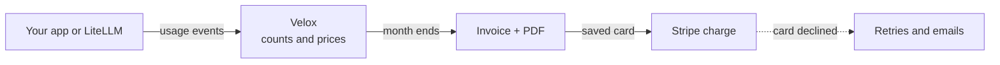

# Velox

### Meter every token. Sell prepaid commits. Know your margin.

[](https://github.com/getvelox/velox/actions/workflows/ci.yml)
[](https://go.dev)
[](LICENSE)
[](CHANGELOG.md)

**Open-source billing for AI and usage-based products, on your own servers.**

Velox counts what each customer uses, such as tokens, prices it, makes the invoice and its PDF, and charges the card through Stripe. Your billing data stays in your own database.

---

## What it looks like

One month of AI usage for one customer, straight from the [demo](#quick-start).

**1. The invoice your customer gets.** One line per model and token type, priced per million tokens.

<picture>
  <source media="(prefers-color-scheme: dark)" srcset="docs/assets/readme-invoice-dark.png">
  
</picture>

**2. Your margin, per model.** What each model earned you: Sonnet 67.1%, Haiku 20.0%.

<picture>
  <source media="(prefers-color-scheme: dark)" srcset="docs/assets/readme-margin-dark.png">
  
</picture>

---

## How it works



Your app tells Velox what each customer used. Once the customer and its prices exist, one usage event looks like this:

```bash
curl -X POST http://localhost:8080/v1/usage-events \
  -H "Authorization: Bearer $VELOX_KEY" \
  -H "Content-Type: application/json" \
  -d '{"event_name": "tokens",
       "external_customer_id": "acme",
       "quantity": 1200,
       "dimensions": {"model": "claude-sonnet-4.5", "token_type": "input"},
       "idempotency_key": "req-42:input"}'
```

`external_customer_id` is your own ID for the customer. The `dimensions` pick the price: here, Sonnet 4.5 input tokens. If you send the same `idempotency_key` again, Velox counts the event once. Already run a [LiteLLM](docs/integrations/litellm.md) proxy? It sends these events for you. [Your first invoice, step by step](docs/first-invoice.md)

---

## Quick start

Try Velox on your own computer in about five minutes. Think of it as a demo car at a showroom: you drive it, you don't build it.

You need git and Docker 24 or newer with the Compose plugin. On Windows, run it inside WSL.

**1. Start Velox**

```bash
git clone https://github.com/getvelox/velox.git
cd velox/deploy/compose
./quickstart.sh
```

**You see:** "Velox is running.", then your dashboard address, email, password and a test API key. The password is shown only once; the script also saves all four in `deploy/compose/quickstart-credentials.json`.

Open `http://localhost:8080` and sign in. Velox opens in test mode, where no real money moves, and it is empty.

**2. Run the demo**

```bash
./quickstart.sh demo
```

In about two minutes, the demo sets up AI token prices, creates a customer and sends token usage the way a LiteLLM proxy would. Then it moves the customer's test clock (a pretend clock for test customers) to the end of the month, and Velox makes the invoice, its PDF and the margin report shown above.

**You see:** nine steps, each ending in a green ✓, then links to the invoice and the customer. Home still reads $0, because its totals leave out test-clock customers; use the links instead. [Each demo step, and where to click](docs/quick-start.md)

**3. Stop or remove it**

`./quickstart.sh stop` keeps your data. `./quickstart.sh destroy` deletes it, and cannot be undone. If port 8080 is taken, start with `VELOX_PORT=9000 ./quickstart.sh`.

**Next:** [send your own usage and get a first invoice](docs/first-invoice.md) · [run it for real on one VM](docs/production-one-vm.md) · [change Velox itself](CONTRIBUTING.md#development-setup)

---

## Why Velox

Small AI teams kept running into the same gaps. Velox is built for them.

| The gap | What Velox does |
|---|---|
| **Stripe Billing takes a cut:** 0.7% of billing volume on its pay-as-you-go plan, and its basic usage billing can't price each model and token type on one meter. | **No Stripe Billing fee.** Stripe only charges the card. One meter prices every model and token type. |
| **Key parts sit behind a paid licence,** such as automatic failed-payment retries and invoice previews in Lago. | **One MIT licence, nothing held back.** |
| **They are heavy to run:** some default setups run nine or eleven services, including Kafka and ClickHouse. | **Three parts:** the Velox server, Postgres and Redis. |
| **No way to fast-forward time** to test a billing change. | **Test clocks:** months of billing in minutes. |
| **No idea which customers lose you money.** | **Margin per customer and per model.** |

Stripe still charges its normal card fee, and Stripe Tax's fee if you use it. Every claim above has a source in [Why Velox exists](docs/why-velox.md), and [How it compares](docs/comparison.md) lists where the other projects are ahead.

**Pre-1.0.** Velox is young: one maintainer, Stripe and cards only, no SDKs yet. Until 1.0.0, breaking API changes land on minor releases ([versioning policy](CHANGELOG.md)).

---

## Is Velox right for you?

**A good fit if:**

- **You charge by usage,** most of all an AI product that prices per token, by model and token type.
- **You want billing on your own servers.** Usage and invoice records stay in your own Postgres. Stripe sees each charge, and the invoice lines too if you use Stripe Tax.
- **You are a small or mid-size team.** One engineer can run it, on one server or several.
- **Your volume is up to about a million usage events a day,** roughly 400,000 AI requests. In a 20-minute test, a €6.49-a-month server (2 CPUs, 4 GB) handled that rate with no errors. Velox keeps every raw event, so plan about 15 to 20 GB of database disk per month at that volume. [How we measured](docs/scale.md)

**Not a fit if you need:**

- **Simple per-seat pricing paid by card.** Stripe Billing already does that well.
- **Automatic charging through a processor other than Stripe.** Stripe is the only one built in today. [Tell us which one you need](https://github.com/getvelox/velox/issues).
- **A marketplace that splits payouts** between sellers (Stripe Connect). Velox bills your own customers.
- **Revenue recognition or accounting reports.** Export the data to your own warehouse.
- **Quotes or multi-phase contracts** for sales-led deals.

---

## What's inside

- **Pricing:** flat, per-unit, graduated and package prices; rates per model and token type on one meter; a base fee plus usage on one invoice; prepaid credit that later usage draws down. [AI pricing](docs/ai-pricing.md)
- **Billing you can trust:** Velox never bills the same period twice, because the database refuses a second invoice for it. Every usage line on an invoice links to the events behind it. [How Velox is engineered](docs/ENGINEERING.md)
- **Getting paid:** cards through Stripe, with automatic retries and emails when a payment fails. Customers can also pay another way, such as a bank transfer, and you mark the invoice paid. [Card payment failure handling](docs/payments.md)
- **Running it:** one Go program with its background jobs inside, Postgres and Redis. No telemetry and no licence check. [Self-host](docs/self-host.md)

Every feature: [What's in the box](docs/features.md).

---

## Docs

[`docs/README.md`](docs/README.md) lists every doc by what you want to do: decide if Velox fits, try it, connect your product, run it in production, or contribute. Good places to start:

- [How Velox works](docs/how-velox-works.md): from a usage event to a paid invoice, step by step
- [How it compares](docs/comparison.md) with Lago, OpenMeter, Flexprice and Kill Bill
- [Roadmap](docs/roadmap.md) · [Changelog](CHANGELOG.md)

---

## Community and contributing

- **Questions, or evaluating a deployment:** [GitHub Discussions](https://github.com/getvelox/velox/discussions)
- **Bugs:** [Issues](https://github.com/getvelox/velox/issues). Money-path bugs are triaged first.
- **Security:** [`SECURITY.md`](SECURITY.md). Report privately, not in a public issue.
- **Contributing:** [`CONTRIBUTING.md`](CONTRIBUTING.md).

## License

[MIT](LICENSE)
