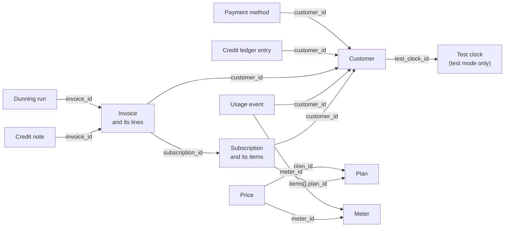

# The data model

This page shows the objects Hardcount keeps, how they point to each other,
and which ones you create. Read it once before you build an integration:
every other page uses these names.

The objects form a chain. A customer subscribes to a plan. The plan's
prices name meters. Usage events fill the meters. At the end of each
period, the subscription becomes an invoice, which credit and card
payments settle.

## The objects and the fields that link them

Each arrow is a field on the object it starts from. For example, a usage
event carries `customer_id` and `meter_id`. You send a usage event with
your own names, `external_customer_id` and `event_name`, and Hardcount
stores the IDs they point to.

## One line per object

| Object | What it is | Who creates it | ID starts with |
|---|---|---|---|
| Customer | A person or company you bill. `external_id` is your own ID for it. | You | `hc_cus_` |
| Meter | A counter for one kind of usage, such as tokens. Its `event_name` is the name usage events send. | You, or a recipe | `hc_mtr_` |
| Plan | What you sell: a currency, a monthly or yearly period, an optional base fee, and prices. | You, or a recipe | `hc_pln_` |
| Price | One usage rate of a plan: a meter, the labels an event must carry, and the rate. | You, or a recipe | `hc_prc_` |
| Subscription | Puts a customer on one or more plans. Each plan is an item with a quantity. | You | `hc_sub_` |
| Usage event | One "this customer used this much" record, sent by your app or a LiteLLM proxy. | You | `hc_evt_` |
| Invoice | A bill for one customer. Its lines say what each part costs. | Hardcount, at each period end and for a plan change. You, for a one-off invoice. | `hc_inv_` |
| Credit note | A document that lowers what a customer owes on an invoice, or refunds a paid one. | You. Hardcount, for credit after a downgrade or cancel, and for a refund made in Stripe. | `hc_cn_` |
| Credit ledger entry | One change to a customer's prepaid credit: a grant, a use, an expiry or an adjustment. | You, for grants and adjustments. Hardcount, for uses, expiries and prepaid commits. | `hc_ccl_` |
| Payment method | A card the customer saved through Stripe. | The customer, on a Stripe page | `hc_pm_` |
| Dunning run | Hardcount retrying one unpaid invoice and emailing the customer. | Hardcount, when a charge fails or no card is saved | `hc_drun_` |
| Test clock | A pretend clock for test customers. | You | `hc_tclk_` |

Two more objects stand apart from the chain:

- **A webhook endpoint** is a URL in your app that Hardcount sends events
  to, such as `invoice.paid`. You create it.
- **A provider cost** is what an AI provider charges you per token, used
  for your margin. You create it.

## What you create, and what Hardcount creates

You create the setup and send the usage:

1. Meters, plans and prices. One recipe call can create all three for AI
   tokens.
2. A customer, with your `external_id`.
3. A subscription that puts the customer on a plan.
4. Usage events, as your customers use your product.

Hardcount does the rest on its own:

- At the end of each billing period it makes the invoice and its lines.
- It uses any credit the customer holds, then charges the saved card
  through Stripe.
- When a charge fails, it starts a dunning run.
- It writes the credit ledger entries for credit used and credit expired.
- It sends a webhook for each of these steps.

## Test mode and live mode

Every object lives in one mode, test or live, and the two never mix. A key
that starts with `hc_secret_test_` sees only test objects. A test clock
exists only in test mode, so only test customers can be on one.

**Next:** [Usage events](usage-events.md).
More: [How Hardcount works](../how-hardcount-works.md),
[Glossary](../glossary.md).
