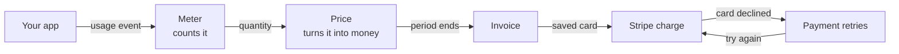

# How Hardcount works

Hardcount turns what your customers use into a paid invoice. Your app tells
Hardcount what each customer used. Hardcount counts it, prices it, makes the
invoice, and charges the card through Stripe. When a payment fails, Hardcount
tries again.

Think of a taxi meter. It counts the distance, the fare card says what each
kilometre costs, and at the end you get a receipt and pay by card. Hardcount
does the same for usage, such as AI tokens or API calls.

## The six steps

1. **Your app reports usage.** Each time a customer uses something, your
   app sends Hardcount a usage event: which customer, which meter, how much,
   and an idempotency key (a unique ID, so a resent event is counted once).
   It can add labels, such as the AI model and the token type. You send it
   with `POST /v1/usage-events`, or let a
   [LiteLLM proxy](integrations/litellm.md) send it for you.

   **You see:** the event on the **Usage** page, and on the customer's page
   under **Customers**.

2. **A meter counts it.** A meter is a counter for one kind of usage,
   such as tokens.

   **You see:** **Pricing**, then the meter. Its page lists the plans that
   price it.

3. **A plan's prices turn the count into money.** A plan has a base fee
   and a price for each meter it charges: a rate per unit, tiers, or
   packages. A price can take only the events with certain labels, so one
   Tokens meter can have a rate for each model and token type. A
   subscription puts a customer on a plan and sets their billing period,
   such as each month.

   **You see:** the plan under **Pricing**, the subscription under
   **Subscriptions**, and the bill so far under "Upcoming invoices" on the
   customer page.

4. **The period ends, and Hardcount makes the invoice.** By default this
   happens 1 to 2 hours after the period ends. Hardcount waits an hour so that
   usage arriving a little late is still billed, and its billing run is
   hourly. The invoice has one line for each price, plus the base fee and
   any tax. Then the invoice is finalized: issued, and no longer a draft.
   Hardcount tells your app with an `invoice.finalized` [webhook](webhooks.md).

   **You see:** the invoice under **Invoices**. Its page shows each line,
   and its **⋯** menu has the PDF.

5. **Credit pays first, then Stripe charges the card.** Right after the
   invoice is finalized, Hardcount uses any credit the customer holds, such as
   prepaid credit (a prepaid commit), to lower the amount due. So the
   `invoice.finalized` webhook shows the amount before credit. If credit
   covers it all, the invoice is marked paid with no charge. Otherwise, if
   the customer has a saved card and your Stripe account is connected,
   Hardcount asks Stripe to charge that card for what is left. With no saved
   card, Hardcount starts dunning (step 6) and, once email is set up, emails
   the customer a link to add one; the next retry after they add it charges
   the card.

   **You see:** the invoice reads **Paid**, with a "Credits applied" line
   if credit paid part of it. The payment shows in your Stripe dashboard.

6. **A failed payment is tried again.** When a charge fails, Hardcount starts
   dunning: it retries the charge on a schedule and, once email is set up,
   emails the customer. Each retry first uses any credit the customer got
   since the last try, so credit added later can pay an older invoice. If
   every retry fails, it does what your dunning policy says: pause or
   cancel the subscription, write off the invoice, both, or neither. A
   pause from dunning lifts by itself once the customer pays that
   invoice, unless the subscription was canceled; a pause you set lasts
   until you resume it, or until its end date if you gave one.

   **You see:** the invoice on the **Dunning** page while it is being
   retried. The schedule is under **Dunning policies**. A new account
   starts with "Default retries": three retries over two weeks, after
   which the subscription keeps billing and the invoice stays open.

## See it without waiting a month

Move a customer's [test clock](glossary.md#testing-with-simulated-time)
forward, and steps 4 to 6 happen in seconds. A month brings the invoice and
its charge; two more weeks bring the retries (day 3, 7 and 14 by default). The quick start does
this for a demo customer, up to the invoice: it connects no Stripe account,
so nothing is charged.

**Next:** see these six steps run on your computer: [quick start](quick-start.md).
