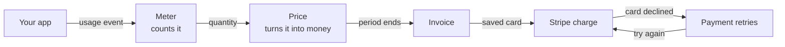

# How Velox works

Velox turns what your customers use into a paid invoice. Your app tells
Velox what each customer used. Velox counts it, prices it, makes the
invoice, and charges the card through Stripe. When a payment fails, Velox
tries again.

Think of a taxi meter. It counts the distance, the fare card says what each
kilometre costs, and at the end you get a receipt and pay by card. Velox
does the same for usage, such as AI tokens or API calls.

**Who it is for:** anyone who wants the big picture before reading the API
or running Velox. Each word is explained where it first appears, and again
in the [glossary](glossary.md).

## The six steps

1. **Your app reports usage.** Each time a customer uses something, your
   app sends Velox a usage event: which customer, which meter, how much,
   and an idempotency key (a unique ID, so a resent event is counted once).
   It can add labels, such as the AI model and the token type. You send it
   with `POST /v1/usage-events`, or let a
   [LiteLLM proxy](integrations/litellm.md) send it for you.

   **You see:** the event on the **Usage** page, and on the customer's page
   under **Customers**.

2. **A meter counts it.** A meter is a counter for one kind of usage,
   such as tokens. Rules on the meter (pricing rules) pick events by their
   labels. So one Tokens meter can keep a separate count for each model and token type.

   **You see:** **Pricing**, then the meter. Its page shows the default
   price and the prices for specific values, such as one model.

3. **A price turns the count into money.** Each price is a rating
   rule: a rate per unit, tiers, or packages. A plan puts a base fee and
   the meters it charges together. A subscription puts a customer on a plan
   and sets their billing period, such as each month.

   **You see:** the plan under **Pricing**, the subscription under
   **Subscriptions**, and the bill so far under "Upcoming invoices" on the
   customer page.

4. **The period ends, and Velox makes the invoice.** By default this
   happens 1 to 2 hours after the period ends. Velox waits an hour so that
   usage arriving a little late is still billed, and its billing run is
   hourly. The invoice has one line for each price, plus the base fee and
   any tax. Credit the customer holds, such as prepaid credit (a prepaid
   commit), lowers the amount due. Then the invoice is finalized: issued,
   and no longer a draft. Velox tells your app with
   an `invoice.finalized` [webhook](webhooks.md).

   **You see:** the invoice under **Invoices**. Its page shows each line,
   and its **⋯** menu has the PDF.

5. **Stripe charges the card.** If the customer has a saved card and your
   Stripe account is connected, Velox asks Stripe to charge that card for
   the amount due. Velox, not Stripe Billing, keeps the invoice, so
   Stripe Billing's fee does not apply. With no saved card, Velox can
   email the customer a link to add one, once email is set up.

   **You see:** the invoice reads **Paid**, and the payment shows in your
   Stripe dashboard.

6. **A failed payment is tried again.** When a charge fails, Velox starts
   dunning: it retries the charge on a schedule and, once email is set up,
   emails the customer. If every retry fails, it does what your dunning
   policy says: pause or cancel the subscription, write off the invoice,
   both, or neither.

   **You see:** the invoice on the **Dunning** page while it is being
   retried. The schedule is under **Dunning policies**.

## See it without waiting a month

A test clock is a pretend clock for test customers. Move it forward a
month, and steps 4 to 6 happen in seconds. The [quick start](quick-start.md)
does this for a demo customer, up to the invoice: it connects no Stripe
account, so nothing is charged.

## Related

[Architecture](architecture.md): how the code is laid out.
